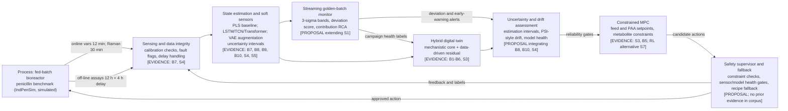

# Project Report

## From Prediction to Trustworthy Closed-Loop Control: A Fault-Aware Digital-Twin Framework for Fed-Batch Fermentation

**A critical literature review and proposed reference architecture for real-time bioreactor monitoring and control**

| Field | Value |
|---|---|
| Date | 29 October 2026 |
| Prepared by | [student name] |
| Prepared with | OpenCode research workspace |
| Status | Research in progress. Track A deliverable: literature review plus proposed architecture. |
| Companion repository | https://github.com/Helios337/bioreactor-digital-twin (private) |
| Governing brief | Bioreactor Research Brief (project handoff document) |

### Integrity statement

This report is a literature-based review and a proposed engineering framework.
It does not claim that a new bioreactor model has been built, trained, or validated.
It does not report experimental performance.
Every cited result is attributed to its original authors.
Proposed elements are explicitly marked as proposals.
Simulated benchmark data is never presented as plant data.

---

## Abstract

Fed-batch fermentation remains one of the most challenging processes to monitor and control in biomanufacturing.
The process is driven by living cells whose internal states cannot be measured directly.
Critical quality attributes such as product concentration are typically available only from off-line assays that arrive 12 hours after sampling with an additional 4-hour laboratory delay.
Sensors fail, process behaviour drifts across campaigns, and most industrial facilities still rely on PID loops and operator-adjusted recipes.
This report presents a scoped critical literature review and a proposed reliability-oriented reference architecture for a fault-aware digital twin of fed-batch fermentation.
The evidence base consists of 19 priority sources: 7 papers read in full text from the project seed corpus, and 12 additional priority papers whose metadata and abstracts were verified against Crossref, OpenAlex, and PubMed.
The review covers mechanistic modelling foundations, the IndPenSim industrial benchmark, soft sensing and state estimation, anomaly detection and root cause analysis, model maintenance under drift, and data-driven control.
Synthesis across the capability matrix shows that the field has strong single-point solutions but no integrated stack: monitoring and control are studied separately, assay delay is rarely treated as a first-class problem, calibrated uncertainty is reported as a metric rather than consumed by decisions, and fallback supervision is absent from every reviewed source.
Five candidate research gaps are stated as hypotheses pending citation chaining, not as established facts.
The report proposes a seven-component reference architecture spanning sensing and data integrity, state estimation and soft sensors, a hybrid digital twin, uncertainty and drift assessment, constrained model predictive control, a safety supervisor with recipe fallback, and feedback to the process.
A staged validation roadmap and a matched-scenario comparison table are defined as future evaluation plans with no results claimed.
The report closes with project status, limitations, and next research decisions.

**Keywords:** fed-batch fermentation, soft sensor, digital twin, process analytical technology, anomaly detection, model predictive control, reinforcement learning, IndPenSim, penicillin.

---

## Table of contents

1. Introduction
2. Process and benchmark background
3. Review methodology and research integrity
4. Monitoring and state estimation: the measurement problem
5. Soft sensing methods for fermentation
6. Anomaly detection, fault diagnosis, and root cause analysis
7. Process modelling and hybrid models
8. Control: from adaptive predictive control to reinforcement learning
9. Model maintenance, drift, and digital-twin context
10. Cross-paper synthesis and capability matrix
11. Candidate research gaps as hypotheses
12. Proposed reference architecture
13. Validation roadmap and proposed evaluation plan
14. Project status, deliverables, and timeline
15. Limitations of this report
16. Future work
17. References
18. Appendix A: Literature evidence matrix (summary)
19. Appendix B: Search protocol summary
20. Appendix C: Verification discrepancy log
21. Appendix D: Glossary and abbreviations

### How to read citations in this report

Sources are cited with bracketed keys that match the companion repository.
Keys B1 to B12 refer to the 12 priority papers from the project brief.
Keys S1, S3, S4, S5, S6, S7 refer to the 7 seed PDFs read in full text (S2 is the same paper as B7).
Every source carries an evidence level:

- **full-text**: the complete paper was read (seed corpus plus B7).
- **abstract**: metadata and abstract verified; full text pending.
- **metadata**: bibliographic fields verified only.

Claims from abstract-level sources are phrased conservatively and marked as abstract-level where the distinction matters.

---

## 1. Introduction

### 1.1 Background

Biopharmaceutical manufacturing increasingly depends on fed-batch fermentation, in which living cells are the actual production units [S7].
Unlike conventional chemical processes, the reactor environment can be manipulated, but the intracellular reactions that produce the product cannot be controlled directly [S7].
Cells are complex, autonomous systems with internal regulatory mechanisms, heterogeneously distributed inside the reactor, and their behaviour changes over a batch [S7].
This creates a monitoring and control problem with no direct equivalent in other process industries.

Regulatory initiatives have shaped the response.
The FDA's Process Analytical Technology framework and the Quality by Design paradigm push manufacturers to understand and control processes through measurement and design rather than end-product testing [B7].
The IndPenSim benchmark paper notes, however, that biopharmaceutical adoption of advanced process control still lags behind sectors such as oil and gas, semiconductors, and automotive [B7].
In practice, control of biopharmaceutical processes has rarely evolved beyond PID control of a small set of variables [S3].

The data situation is paradoxical.
Modern facilities record vast amounts of process data, yet fermentation datasets are small by machine-learning standards, and sensor lag, missing values, and corruption limit the applicability of data-driven methods [S4, S6].
Reviews of machine learning in bioprocessing identify data scarcity, lagging cyber-integrated sensor systems, and storage scalability as the main constraints on real-time application [S6].

### 1.2 Problem statement

Five properties of fed-batch fermentation make reliable real-time monitoring and control hard.

First, critical quality attributes are measured late.
In the industrial penicillin benchmark, off-line assays for penicillin, biomass, phenylacetic acid, and nitrogen are sampled every 12 hours and arrive with a predefined 4-hour delay [B7].
Substrate concentration has no off-line measurement at all [B7].
A controller or operator acting on such information is always acting on stale or missing state.

Second, sensors fail.
The benchmark explicitly models agitator trips, aeration faults, substrate faults, and sensor errors [B7].
Experimental soft-sensor work confronts noisy probes, malfunctioning redox sensors, and corrupt data [S4].

Third, the process drifts.
Batch-to-batch variation, campaign-to-campaign variation, and time-varying dynamics are documented in the benchmark [B7], and concept drift of deployed soft sensors is an active industrial concern [B8].

Fourth, uncertainty is rarely propagated.
Most soft sensors report point predictions and accuracy metrics, but the reviewed corpus contains no example of calibrated prediction uncertainty being used to gate monitoring alerts or control decisions.

Fifth, monitoring and control are decoupled in the literature.
Anomaly detection and root cause analysis are typically post-hoc [S1].
Control designs consume models but not monitoring health signals [S3, S7].
No reviewed source closes the loop from estimation through monitoring to control with a documented fallback.

### 1.3 Project objectives

The project pursues five objectives.

1. Verify and organize a defensible evidence base of priority papers, with full metadata verification and access-status tracking.
2. Synthesize the evidence against five research questions covering sensing, model classes, reliability handling, control linkage, and validation.
3. Propose a reliability-oriented reference architecture for a fault-aware digital twin of fed-batch fermentation.
4. Define a staged validation roadmap and a matched-scenario comparison plan, without claiming results.
5. Deliver reproducible artifacts: a verified bibliography, an evidence matrix, a search protocol, a screening log, and project-local review skills.

Explicit non-goals follow from the governing brief.
This project does not train a new machine learning model, does not download or process the full IndPenSim dataset during the review phase, and does not claim experimental performance.
An empirical monitoring prototype is defined as a gated later phase and is triggered only after the gap analysis confirms the need and the user explicitly requests implementation.

### 1.4 Research questions

- **RQ1.** Which measurements and soft sensors are used to estimate critical process states in fed-batch fermentation?
- **RQ2.** When are mechanistic, data-driven, hybrid, and observer-based models appropriate?
- **RQ3.** How do existing systems address measurement latency, sensor faults, distribution shift, and predictive uncertainty?
- **RQ4.** How are model predictions linked to constrained model predictive control and safe fallback decisions?
- **RQ5.** What validation evidence is needed to demonstrate reliability beyond offline prediction accuracy?

RQ3 carries the most weight in this synthesis because the project's monitoring emphasis makes reliability the central concern.

### 1.5 Scope

In scope: batch and fed-batch fermentation with penicillin as the benchmark process; soft sensing and state estimation; measurement latency; sensor faults; drift; predictive uncertainty; fault detection, anomaly detection, deviation analysis, and root cause analysis; control linkage through constrained MPC, learning-based control, and supervisory fallback; and validation evidence types.

Out of scope: continuous-only bioprocessing without batch relevance; strain and metabolic engineering; downstream purification; bioreactor hardware design; and clinical or regulatory submission detail beyond the PAT and QbD context.

A recurring distinction is applied throughout: penicillin-specific evidence is separated from transferable methods demonstrated on other bioprocesses, such as L-phenylalanine state estimation [B10] or microalgal photobioreactor pH control [S7].

### 1.6 Report structure

Chapter 2 fixes the process and benchmark background.
Chapter 3 documents the review methodology and integrity controls.
Chapters 4 to 9 review the evidence by theme.
Chapter 10 synthesizes across sources with a capability matrix.
Chapter 11 states the candidate gaps as hypotheses.
Chapter 12 presents the proposed architecture.
Chapter 13 defines the validation roadmap.
Chapters 14 to 16 cover status, limitations, and future work.
References and appendices close the report.

---

## 2. Process and benchmark background

### 2.1 Penicillin fed-batch fermentation and its mechanistic modelling lineage

Penicillin fermentation is the reference process for this project because it is the process underlying the only freely available industrial-scale benchmark dataset with Raman spectra [B7].

The mechanistic modelling lineage starts with Bajpai and Reuss, whose 1980 paper "A mechanistic model for penicillin production" established a kinetic model covering growth, substrate inhibition, and oxygen limitation [B1].
The verified record places it in the Journal of Chemical Technology and Biotechnology, volume 30, issue 1, pages 332 to 344, and it remains the most cited foundational model in the corpus with 190 recorded citations in OpenAlex.
Menezes and co-authors extended modelling to industrial pilot-plant penicillin-G fed-batch fermentations in 1 m3 stirred tanks, and their abstract-level evidence indicates that assumptions and parameters may need revision when moving between process settings [B2].
Zangirolami and co-authors introduced a morphologically structured model with compartments and inhibition effects, demonstrating the value and the complexity cost of representing fungal morphology explicitly [B3].

Birol, Undey, and Cinar turned this lineage into a modular simulation package for penicillin production [B4].
Their abstract states that the simulator extends the Bajpai-Reuss mechanistic model with input variables for pH, temperature, aeration rate, agitation power, and substrate feed flow rate, and introduces a carbon-dioxide evolution term.
The same abstract reports that the package was used for monitoring and fault diagnosis of a typical penicillin fermentation, which makes it the earliest monitoring-oriented precedent in the corpus [B4].

Montague and co-authors provide the historical control anchor [B5].
Their 1985 IFAC paper applies parameter adaptive control to mould growth in a fed-batch penicillin fermentation.
Per the abstract, biomass was controlled to a reference trajectory using an on-line biomass estimate derived from carbon-dioxide measurement, the Bajpai model, and an extended Kalman filter, inside a Generalised Predictive Controller, a long-range receding-horizon predictive control scheme.
Real-time experiments were carried out on a 20-litre pilot-plant fermenter, and the work was part of an industrial collaborative project aimed at optimising control of large fed-batch fermenters [B5].
Two lessons follow.
Predictive control of penicillin fermentation is not a new idea.
And state estimation from off-gas has a four-decade pedigree.

Goldrick and co-authors completed the lineage to the modern benchmark by developing an industrial-scale fed-batch fermentation simulation validated against industrial batch records [B6].
That simulation became the core of IndPenSim.

### 2.2 The IndPenSim benchmark

IndPenSim is an industrial-scale simulation of a 100,000-litre penicillin fermentation using a high-yielding strain of Penicillium chrysogenum [B7].
It accurately simulates all available process inputs and outputs, and it mimics a real plant through batch-to-batch variation of biomass and penicillin concentration, in-batch fluctuations, delays in off-line assay measurements, manual operator intervention in feeding strategies, inaccurate sensor readings, and random deviations in growth and production levels [B7].

Table 2.1 summarizes the measurement landscape, which is central to every monitoring argument in this report.

**Table 2.1. IndPenSim measurement landscape [B7, full-text].**

| Variable | Cadence | Type | Notes |
|---|---|---|---|
| Dissolved oxygen (DO) | 12 min | online | controlled above 10% saturation via agitation and air flow |
| Weight (W) | 12 min | online | mass balance window 70,000 to 110,000 kg |
| pH | 12 min | online | PID loop via acid/base flow |
| Temperature (T) | 12 min | online | PID loop via cooling flow |
| Off-gas CO2 and O2 | 12 min | online | not controlled; source of OUR, RQ features |
| Penicillin (P) | 12 h + 4 h delay | off-line | target: maximize production |
| Biomass (X) | 12 h + 4 h delay | off-line | no direct online measurement |
| Phenylacetic acid (PAA) | 12 h + 4 h delay | off-line | maintain 600 to 1800 mg/L |
| Nitrogen (N) | 12 h + 4 h delay | off-line | maintain above 300 mg/L |
| Viscosity | 12 h + 4 h delay | off-line | maintain below 100 cP |
| Substrate (S) | none | not measured off-line | pure inferential target |
| Raman spectra | 30 min | online PAT | 200 to 2400 cm-1, 3 cm-1 resolution |

Three properties of this landscape drive the architecture proposed later in this report.
The off-line cadence is 12 hours with a 4-hour delay, so laboratory confirmation of a problem arrives roughly half a day late [B7].
Substrate concentration has no off-line measurement whatsoever, so any substrate-aware monitor must be entirely inferential [B7].
And a Raman spectra channel exists every 30 minutes, which makes a chemometrics soft-sensor route feasible [B7].

The control structure is deliberately conventional.
Temperature and pH run under PID loops.
Substrate feed rate and phenylacetic acid feed rate follow a fixed recipe or are adjusted by an operator, replicating observed industrial practice [B7].
The benchmark's stated control objectives include maximizing annual penicillin production, reducing yield variation, identifying critical process parameters and quality attributes, enhancing pH and temperature control, manipulating substrate, nitrogen, or PAA flowrates, building a Raman soft sensor, and calculating optimal harvest time [B7].

Campaign-level behaviour is documented across five simulated operating years [B7].
Table 2.2 reproduces the campaign summary.

**Table 2.2. IndPenSim campaign summary [B7, full-text].**

| Campaign | Control strategy | Batch length | Batches | Below-target batches | Average yield per batch (kg) | Annual production (x1000 kg) |
|---|---|---|---|---|---|---|
| 1 | Operator dependent | Fixed | 26 | 2 | 2882 +/- 745 | 74.939 |
| 2 | Recipe driven | Variable | 25 | 8 | 2578 +/- 769 | 64.458 |
| 3 | Operator dependent | Variable | 26 | 6 | 2950 +/- 888 | 76.690 |
| 4 | Recipe driven | Fixed | 26 | 2 | 2912 +/- 786 | 75.716 |
| 5 | Operator dependent | Fixed | 26 | 5 | 2816 +/- 796 | 73.228 |

The target production yield is 2,000 kg of penicillin per batch, and batches below that threshold trigger investigation [B7].
The campaign table shows that operator-dependent and recipe-driven control both produce below-target batches, and that annual production varies by more than 12,000 kg across regimes [B7].
This is the quantified motivation for advanced monitoring and control.

The benchmark also integrates a realistic Raman spectroscopy device.
The simulated spectra were generated from experimental Raman spectra recorded on a 5-litre fungal fermentation producing a commercially available antibiotic, using a Kaiser RXN system with an InGaAs detector, 200 to 2400 cm-1 range, 3 cm-1 resolution, one spectrum every 30 minutes from 9 averages at 180-second integration [B7].
The simulation includes fluorescence baseline increase, peak shifts, noise, and random cosmic spikes, and a PLS calibration on the spectra predicted off-line penicillin concentration with comparable accuracy [B7].

Finally, IndPenSim can inject process faults including agitator trips, aeration faults, substrate faults, and sensor errors, and disturbances on inlet concentrations of substrate, oil, acid/base, and PAA [B7].
A dataset of 100 batches, approximately 2.5 GB, with all online, off-line, and Raman measurements is freely downloadable [B7].
Two integrity caveats apply.
The data are generated by a simulator and are not equivalent to raw measurements from an operating plant [B7].
And the dataset version and licence must be documented before any reuse, which is why the review phase deliberately does not download it.

### 2.3 PAT, QbD, and the CQA/CPP framing

The benchmark paper demonstrates a Quality by Design methodology using the three stages of the PAT framework [B7].
In this framing, critical quality attributes are viewed as functions of critical process parameters, and experiments vary the parameters to map effects on quality [S6].
The golden-batch root cause analysis method adopts the same vocabulary, with operator-defined CQAs and CPPs, and uses deviations of CQAs from a golden profile to rank CPP contributions [S1].
This shared vocabulary is what allows the monitoring layers proposed in this report to communicate with operators and with regulators in established terms.

### 2.4 The soft sensor concept

A soft sensor combines easily measured auxiliary variables with a mathematical model to estimate variables that are hard to measure directly [S5].
The fermentation literature is explicit that cell concentration, substrate concentration, and product concentration cannot be measured online with practical instruments, that off-line testing carries a time lag, and that soft sensing is the established route to real-time estimation [S5].
The development methodology reviewed by Zhu and co-authors has four stages: data collection and preprocessing, variable selection, model selection, training and validation, and performance evaluation [S5].
This report adopts that four-stage structure when evaluating the estimation layer of the proposed architecture.

---

## 3. Review methodology and research integrity

### 3.1 Review type

This is a scoped critical literature review with a reproducible search protocol.
It is not a systematic review, and it does not claim PRISMA compliance.
PRISMA 2020 vocabulary is used only to structure the search log and screening counts [B12].
The decision to keep the review scoped rather than systematic is deliberate: the goal is a defensible evidence base for an architecture proposal, not an exhaustive census of the field.

### 3.2 Search protocol

The protocol defines nine exact search strings mapped to the research questions, a date window from 1980 to the present, and explicit inclusion and exclusion criteria.
Table 3.1 lists the strings.

**Table 3.1. Search strings (database syntax per repository protocol).**

| ID | String | Serves |
|---|---|---|
| S1 | ("fed-batch" OR "fed batch") AND fermentation AND ("soft sensor" OR "soft-sensor" OR "state estimation") | RQ1, RQ2 |
| S2 | ("penicillin fermentation") AND ("model predictive control" OR MPC OR "reinforcement learning") | RQ4 |
| S3 | (bioprocess OR fermentation) AND ("digital twin") AND (monitoring OR control) | RQ2, RQ5 |
| S4 | (fermentation OR bioprocess) AND ("fault detection" OR "fault diagnosis" OR "sensor fault") | RQ3 |
| S5 | ("process analytical technology" OR PAT) AND (Raman OR spectroscopy) AND fermentation | RQ1 |
| S6 | (fermentation OR bioprocess) AND ("concept drift" OR "model drift" OR "model maintenance") AND ("machine learning" OR "soft sensor") | RQ3 |
| S7 | ("golden batch" OR "deviation analysis") AND (fermentation OR bioprocess) AND (anomaly OR "root cause") | RQ3 |
| S8 | (bioprocess OR fermentation) AND ("uncertainty quantification" OR "conformal prediction") AND ("soft sensor" OR "state estimation") | RQ3 |
| S9 | (bioprocess OR fermentation) AND ("fault-tolerant control" OR "supervisory control" OR fallback) AND (MPC OR "model predictive") | RQ4, RQ5 |

Databases: OpenAlex, Crossref, PubMed and PubMed Central, Semantic Scholar (optional), publisher pages, and citation chaining through reference lists and cited-by records.
Inclusion criteria: batch or fed-batch fermentation relevance; monitoring, estimation, fault, drift, uncertainty, or control content; English; verifiable metadata; accessible abstract or full text.
Exclusion criteria: continuous-only processes without batch relevance; pure metabolic engineering; records with unverifiable metadata; duplicates.

Screening status at the time of writing: the four monitoring-critical strings S1, S4, S6, and S7 were piloted against OpenAlex, returning 1,014, 2,435, 245, and 37 hits respectively.
The top 25 results per pilot were screened against the corpus, 4 were already included, and 94 new candidates were logged as pending-screen with unverified-hit status.
The remaining strings and the full screening of candidates are the next planned increment.

### 3.3 Reference verification method

Every source was verified before citation.
DOI metadata was queried against Crossref.
Citation counts and open-access status were queried against OpenAlex.
Biomedical records were cross-checked against PubMed.
Publisher pages supplied abstracts where APIs did not.
Each source carries an access status: metadata-verified, abstract-read, or full-text-read.

The verification process surfaced six discrepancies or notable events, recorded in the repository's source register and summarized in Appendix C.
The most instructive case is the 1997 Zangirolami paper, whose SICI-format DOI is not resolvable by the Crossref API.
It was independently confirmed through PubMed (PMID 18642330) and OpenAlex, including its pagination 56(6):593-604, and the discrepancy was logged rather than silently resolved.
A second case concerns the 1985 IFAC paper, for which the brief listed no authors; Crossref identifies Montague, Morris, Wright, Aynsley, and Ward.
A third case concerns the 2026 Shukla review, whose ahead-of-print record was confirmed in Crossref and on the journal site; it is flagged for re-verification at submission time.

### 3.4 Evidence extraction

Evidence is extracted into a matrix with fixed columns: full citation, DOI or URL, process and scale, model class, measured inputs, predicted or estimated states, control method, faults/delays/drift considered, validation setup, key findings, limitations, access status, and relevance to the proposed framework.
A second cross-paper capability matrix scores every source on seven dimensions: delayed sensing, sensor faults, drift, uncertainty, closed-loop control, fallback, and validation type.
For each paper, what the authors explicitly report is kept separate from the reviewer's interpretation, and both are kept separate from this project's proposals.

### 3.5 Integrity controls

The following controls bind this report and the repository behind it.

- No fabricated citations, results, numbers, equations, data-availability claims, or limitations.
- Access status is tracked per source, and abstract-only reading is never presented as full-text reading.
- Candidate gaps are hypotheses until citation chaining confirms them.
- Input-distribution drift, sensor fault, prediction uncertainty, and unsafe control are treated as distinct concepts.
- The proposed architecture is described as proposed, reliability-oriented, and to be evaluated.
- Tool output, including API responses, is evidence gathering, not scientific validation.

---

## 4. Monitoring and state estimation: the measurement problem

### 4.1 What is measurable, and when

The IndPenSim measurement landscape (Table 2.1) divides into three classes.
Online physical and chemical variables (dissolved oxygen, weight, pH, temperature, off-gas composition) are available every 12 minutes.
Raman spectra arrive every 30 minutes as a process analytical technology channel.
Critical biological variables (penicillin, biomass, PAA, nitrogen, viscosity) are available only from off-line assays every 12 hours, with a further 4-hour delay.
Substrate concentration has no off-line measurement at all [B7].

Two derived quantities deserve mention because they are cheap to compute from online channels and are standard in fermentation monitoring.
Our rate of oxygen uptake and the respiratory quotient can be computed from the off-gas CO2 and O2 channels.
Mass-balance features can be computed from the weight channel.
The benchmark's own control objectives explicitly include a Raman soft sensor for PAA, biomass, or penicillin [B7], which legitimizes the inference route.

### 4.2 The cost of delay

The practical consequence of the 12-hour plus 4-hour assay pipeline is that laboratory confirmation of a developing problem arrives roughly half a day after the sample was taken, and a full day after the process state that caused it.
For a batch that runs about 230 hours, this means a monitor that only reacts to assay data is blind for the majority of the batch.
This report's interpretation, marked as such, is that the single largest monitoring gain available in this setting comes from moving detection earlier by inferring the delayed variables from online channels, and from comparing running batches against a healthy reference profile in real time.
The early-warning lead time, measured in hours against the assay timeline, is proposed as a headline evaluation metric for the gated empirical phase.

### 4.3 Sensor faults and data corruption

Fault handling appears in the corpus in two distinct forms.
The benchmark models process and sensor faults as first-class scenarios: agitator trips, aeration faults, substrate faults, and sensor errors, plus disturbances on inlet concentrations [B7].
Its Raman simulation goes further and models fluorescence baseline increase, peak shifts, noise, and random cosmic spikes, so that chemometrics pipelines must cope with realistic spectral corruption [B7].
Separately, the experimental soft-sensor work of Kwon and co-authors confronts noisy probes, a failed redox sensor, missing data, and corrupt data from improperly calibrated sensors in a real very-high-gravity ethanol fermentation [S4].
Their response was not to clean the data and proceed, but to treat robustness to corruption as a first-class modelling requirement, which motivated their data-augmentation approach reviewed in Chapter 5.

### 4.4 State estimation lineage

Estimating unmeasurable states from measurable ones has a long pedigree in this process.
Montague and co-authors estimated biomass on-line from carbon-dioxide measurement, a mechanistic model, and an extended Kalman filter, and used that estimate inside an adaptive predictive controller on a 20-litre pilot plant [B5, abstract-level].
Hermann and Kremling combine partial least-squares regression with an unscented Kalman filter for bioprocess state estimation, demonstrated on an L-phenylalanine process [B10, abstract-level].
The transferability rule applied throughout this report applies here: the method is evidence for observer-based estimation, but it is not penicillin-specific evidence.

### 4.5 The benchmark as a monitoring testbed, and its labels

The 100-batch IndPenSim dataset supports supervised monitoring evaluation because batch health is known.
Luo and co-authors identify 33 batches as unhealthy, defined by penicillin concentration yields below the 20 g/L target, and 67 as healthy, and they list the batch numbers explicitly [S1, full-text].
Metcalfe and co-authors use the batches containing deviations, numbered 91 to 100, to assess concept drift of their LSTM soft sensor [B8, abstract-level].
These two labelling perspectives are compatible but not identical: one partitions the whole campaign by final quality, the other isolates a deviation cluster for drift study.
The repository records both, and the gated empirical phase must state which labelling it uses for which evaluation.

### 4.6 Monitoring requirements derived from the evidence

The following requirements for the project's monitoring layer are proposals derived from the evidence above, not findings.

- R-M1: estimate the delayed and unmeasured variables online from online channels, Raman spectra, and mass-balance features.
- R-M2: quantify estimation uncertainty and expose it to downstream consumers.
- R-M3: compare each running batch against a healthy reference profile continuously, not post-hoc.
- R-M4: detect sensor faults and data corruption explicitly, separately from process anomalies.
- R-M5: attribute deviations to candidate root causes with contribution rankings and onset timing.
- R-M6: raise early warnings measured in hours of lead time against the off-line assay timeline.
- R-M7: log every alert with the evidence level of the underlying estimate.

---

## 5. Soft sensing methods for fermentation

### 5.1 Taxonomy

Zhu and co-authors provide the corpus's soft-sensing taxonomy [S5, full-text].
They distinguish mechanism-based models, data-driven black-box models, and hybrid models, and they review data preprocessing, variable selection, and optimization of model parameters.
The data-driven families covered include support vector machines, least-squares SVM, multiple-output LS-SVM, neural networks, deep learning, fuzzy logic, and probabilistic latent variable models.
Parameter and structure optimization is surveyed through particle swarm optimization, ant colony optimization, artificial bee colony, cuckoo search, and genetic algorithms.
Their review examines more than 70 publications and reaches two conclusions that matter to this project.
Most existing work is confined to simulation-based experiments.
Only a few efforts deploy soft sensors in industrial applications.
Their stated future direction is adjustable, authentic, adaptive, efficient, and modern soft sensors, which aligns with the reliability emphasis of this report.

### 5.2 Chemometrics baseline: PLS on Raman

The benchmark paper demonstrates the classical route: partial least-squares regression on Raman spectra predicts penicillin concentration with accuracy comparable to off-line assays [B7, full-text].
This is the baseline any modern soft sensor must beat, and it is also the most industrially credible route because PLS is interpretable, fast, and standard in chemometrics practice.
The same paper applies PCA-based monitoring to the batch data, which supplies the statistical-process-control baseline for anomaly detection.

### 5.3 Sequence models

Two abstract-level sources represent the deep-learning route.
Zheng and co-authors develop a supervised hybrid CNN-LSTM network for nonlinear dynamic soft sensing, evaluated on industrial applications including penicillin fermentation [B9].
Metcalfe and co-authors build an LSTM soft sensor for penicillin concentration on the IndPenSim dataset, with real-time prediction and an 8-hour forecast horizon, embedded in a machine-learning-operations lifecycle pipeline [B8].
The MLOps framing of the latter is significant: the abstract states that a deployed model requires more than a learner and a held-out test set, and that production performance can deteriorate rapidly, which motivates their drift-monitoring and retraining-alert machinery discussed in Chapter 9.

### 5.4 Small-data augmentation with variational autoencoders

Kwon and co-authors address the sparse-data problem directly [S4, full-text].
Their case study is intensified very-high-gravity ethanol fermentation from sugarcane, run as 11 cycles in a 3-litre bioreactor.
They train a convolutional variational autoencoder on the original experimental measurements and generate synthetic time series, then train feedforward neural network soft sensors on three datasets: original only, original plus 10 synthetic datasets, and original plus 100 synthetic datasets.
Evaluation uses repeated random splits, 100 iterations, with the generalized coefficient of determination and root mean square error as metrics.
Using augmented datasets, soft-sensor predictive capability improved by 34 percent and variability was reduced by 82 percent, measured on R-squared scores.
The inputs were electrical capacitance, redox potential, pH, and temperature; the target was ethanol concentration.
The paper's own framing is modest and should be preserved: the method offers time and cost savings for dataset generation and can be adapted to other fermentation processes.
It does not establish that synthetic samples are universally safe, and augmentation fidelity remains an open risk.

### 5.5 Observer-based fusion

Hermann and Kremling fuse a data-driven soft sensor with a state estimator, combining partial least-squares regression with an unscented Kalman filter [B10, abstract-level].
The contribution pattern to note is architectural: the data-driven component supplies the measurement model, the observer supplies correction and temporal coherence.
The same pattern appears decades earlier in the extended-Kalman-filter biomass estimation of Montague and co-authors [B5, abstract-level].
This report interprets the recurrence of this pattern as evidence that estimation and correction should be designed as one layer, not bolted together.

### 5.6 Model class comparison

Table 5.1 compares model classes on the evidence available.

**Table 5.1. Model classes for soft sensing and estimation (evidence levels in brackets).**

| Class | Examples in corpus | Strengths | Weaknesses | Evidence |
|---|---|---|---|---|
| Mechanistic first-principles | Bajpai-Reuss lineage [B1-B4, B6] | interpretable, extrapolates within assumptions, embeds mass balance | many unknown parameters, assumptions need revision across settings [B2] | full-text/abstract |
| Classical chemometrics | PLS on Raman [B7] | fast, interpretable, industrially standard, validated on benchmark | linear, needs calibration maintenance | full-text |
| Data-driven regression | FNN with VAE augmentation [S4]; linear and NN regression [S3] | handles nonlinearity; augmentation helps small data | needs data, corruption-sensitive, black-box | full-text |
| Sequence deep learning | CNN-LSTM [B9]; LSTM with MLOps [B8] | captures dynamics; forecast horizons | drift-prone in production; lifecycle overhead | abstract |
| Observer fusion | EKF [B5]; PLS+UKF [B10] | temporal coherence, correction of data-driven estimates | needs a process model; tuning burden | abstract |
| Hybrid mechanistic plus data-driven | mass balance plus regression inside MPC [S3] | exploits physics where known, data where not | design complexity; interface discipline needed | full-text |

### 5.7 Requirements for this project's estimation layer

The following are proposals, not findings.

- R-E1: multi-target estimation of biomass, penicillin, PAA, and substrate, since substrate has no off-line measurement [B7].
- R-E2: PLS on Raman as the mandatory baseline, because the benchmark itself establishes it [B7].
- R-E3: sequence models (LSTM, temporal CNN, Transformer) compared against the baseline under identical splits.
- R-E4: VAE-style augmentation evaluated through learning curves at 10, 20, 40, and 67 labelled batches, so the augmentation benefit is measured rather than asserted [S4].
- R-E5: uncertainty output (ensemble or conformal) attached to every estimate, consumed by the monitoring layer.
- R-E6: phase-aware features, because fermentation behaviour differs between lag, growth, and production phases.

---

## 6. Anomaly detection, fault diagnosis, and root cause analysis

### 6.1 Statistical monitoring baselines

The benchmark paper implements classical multivariate statistical monitoring on IndPenSim data [B7, full-text].
On-line and off-line variables are monitored with PCA, using batch-wise unfolding so that variable trajectories across the batch are preserved.
A monitoring score is computed from all available batch data up to the current time, which makes the method partially online in spirit even though the evaluation is retrospective.
The same paper implements a fault detection algorithm and evaluates it on process faults occurring on different batches recorded throughout a yearly campaign.
These are the baselines that any modern monitoring method on this benchmark must beat, and they are the comparison points used by the golden-batch study discussed next.

### 6.2 The golden batch method

Luo and co-authors introduce a golden-batch-driven root cause analysis method for anomalies in bioreactor fermentation [S1, full-text].
The motivation is industrial: manual root cause analysis of out-of-trend and out-of-spec incidents typically takes 2 to 8 weeks, and the method aims to reduce that to days or hours.

The method has four parts.
First, a golden batch profile is constructed from numerous healthy batches, not from one manually selected batch.
Healthy batches are selected using operator-defined CQA and KPI thresholds, and in the IndPenSim application the golden profile was built from normal-operational batches (for example batches 61 to 90).
Second, every batch is normalized to remove unit effects, and per-time-point statistics are computed.
The golden batch's upper and lower bounds are the per-time-point mean plus and minus three standard deviations, capturing 99.7 percent of healthy behaviour at each sampling instant.
Third, deviation of a specified batch from the golden profile is quantified with a symmetric mean absolute percentage error measure.
Fourth, the contribution of each critical process parameter to the observed deviation of each critical quality attribute is computed, which supports drill-down to the parameter with the highest contribution, and then to the time trajectory of that parameter.

The reported results on IndPenSim are concrete [S1].
Batch 99 deviates by 54.03 percent overall, with divergence starting around 100 hours; pH and dissolved oxygen are the largest contributors, with contribution values of 85 and 80.
Batch 92 deviates by 24.05 percent, starting around 160 hours; base flow rate and dissolved oxygen lead, with contributions of 65 and 48.
Batch 96 is a healthy batch that still shows an 11.52 percent deviation from around 180 hours, with pH and base flow rate as top contributors, which the authors use to argue that even in-spec batches carry diagnostically useful signals.
Compared with traditional PCA-based methods, the approach significantly reduces false positives and false negatives.

The method's limitations are equally concrete and define the extension space for this project.
It is offline and post-hoc: it analyzes completed batches rather than running batches.
Batch alignment is handled by truncating longer batches to the most common duration, which discards phase information.
It does not fuse soft-sensor estimates, does not quantify uncertainty, does not handle sensor faults explicitly, and has no control linkage.
Its greatest strength for this project is interpretability: contribution rankings give operators a when, where, and how narrative, which the authors contrast with the steep learning curve of causal-discovery tools such as doWhy and the false-positive burden of SPC and PCA.

### 6.3 Fault scenarios in the benchmark

IndPenSim's fault catalogue [B7, full-text] is the empirical testbed for any fault monitor.
Process faults include agitator trips, aeration faults, substrate faults, and sensor errors.
Disturbances can be applied to inlet concentrations of substrate, oil, acid/base, and PAA.
The simulator also models random deviations in growth and production levels, inaccurate sensor readings, and delays in off-line measurements.
A monitoring stack intended for this benchmark must therefore distinguish at least four phenomenologies: actuator and equipment faults, feedstock disturbances, sensor faults, and biological variability.
This report treats those as distinct categories, consistent with the terminology discipline defined in Chapter 3.

### 6.4 Robustness to corrupt data

The experimental soft-sensor study of Kwon and co-authors supplies the data-quality half of the story [S4, full-text].
Their fermentation cycles suffered a failed redox sensor, noisy probes, and corrupt records from improper calibration.
Their response, VAE-based synthetic augmentation plus imputation, is reviewed in Chapter 5.
The monitoring lesson is that robustness must be designed into the pipeline: outlier handling, missing-data imputation, and corruption-tolerant features are prerequisites, not afterthoughts.

### 6.5 Requirements for the anomaly and RCA layer

The following are proposals derived from the evidence.

- R-A1: streaming deviation scoring against phase-aware golden bands, replacing truncation-based alignment with time-warping or phase segmentation.
- R-A2: contribution-based root cause ranking computed online at alert time, with change-point detection for onset timing.
- R-A3: fused alert logic combining golden-batch deviation, reconstruction residuals from a multivariate monitor, and soft-sensor uncertainty.
- R-A4: explicit sensor-fault flags that suppress or downgrade alerts from corrupted channels instead of propagating corruption as process anomalies.
- R-A5: early-warning evaluation measured as lead time in hours against the 12-hour plus 4-hour assay timeline.
- R-A6: every alert carries the evidence level of its inputs and a contribution explanation for the operator.

---

## 7. Process modelling and hybrid models

### 7.1 Why hybrids

Two structural problems recur across the corpus.
Mechanistic models embed the right physics but carry many unknown parameters and assumptions that may need revision when the process setting changes [B2, abstract-level; S3].
Data-driven models fit the available data but struggle with the time-varying character of fed-batch fermentation and the limited number of training batches [S3].
The hybrid position, which uses physics where it is known and data where it is not, is recommended by both major reviews in the corpus [S5, S6, full-text] and is the only model class with direct control-facing evidence [S3].

### 7.2 The hybrid control evidence

Rashedi and co-authors provide the corpus's most instructive hybrid result [S3, full-text].
Their process is a fed-batch mammalian cell culture at Amgen, with 35 batches of 12 days and daily sampling.
Operating variables were pH, dissolved oxygen, temperature, and feed; recorded states included viable cell density, total cell density, viability, glucose, lactate, glutamine, glutamate, ammonium, sodium, potassium, and osmolality.
The feed was added in boluses, so the recorded feed input contains many zeros, and this sparsity made the process appear insensitive to the feed in naive models.

Their solution was a hybrid model: a glucose mass balance couples the feed input to glucose levels, and regression models capture the relationship between glucose and the other variables.
Both a linear regression variant and a two-layer neural network variant with six regressors were trained.
The linear model achieved lower one-step-ahead normalized RMSE on every reported metabolite, for example 1.00 versus 1.92 on viable cell density and 1.00 versus 2.02 on glutamine.
The authors selected the linear model for the controller, explicitly citing lower RMSE, simpler structure for optimization, and the convexity of the resulting linear MPC problem.

The controller manipulates the daily feed to maximize viable cell density while keeping metabolites within specification.
The cost function is a sum of squared errors to setpoints over the prediction horizon plus a move-suppression term on the feed.
Constraints include non-negativity and normalized bounds on metabolites such as glucose between 0.2 and 0.8 and viability between 0.4 and 1.
The controller was implemented on a real bioreactor, and the experimental validation confirms more than 2 percent improvement in final protein production compared with the average of historical experiments.

Two cautions from this study should travel with any control proposal.
The single manipulated input (feed) limits how much credit the model class deserves for multivariable control.
And the daily control timescale matches the slow mammalian cell culture, not necessarily faster microbial dynamics.

### 7.3 Digital-twin context

Shukla, Nagpal, and Vyas review digital twins for microbial processes in food fermentation [B11, abstract-level].
Their abstract identifies the enablers of a digital twin system as soft sensors, cloud-integration platforms for data analysis and storage, process analytical tools, machine learning, artificial intelligence, and the Internet of Things.
Opportunities they list include real-time monitoring and control, adaptive control, contamination prediction, metabolite and by-product concentration estimation, and simulation of the physical fermenter.
They also state limitations: results are promising mainly at bench scale, biological variability is high, and standardized frameworks and common data platforms are lacking.
This report uses that review for context and scope boundary only.
It is a food-fermentation review, not a penicillin study, and its evidence is labelled transferable rather than penicillin-specific.

### 7.4 Requirements for the twin's model layer

The following are proposals.

- R-T1: a hybrid structure with a mechanistic core (mass balances, kinetics) and a data-driven residual, following the interface discipline demonstrated in [S3].
- R-T2: declared assumptions, following the scale-transfer caution of [B2].
- R-T3: morphology or structure only where the evidence justifies the complexity cost, following [B3].
- R-T4: a model-maintenance policy that treats retraining as a monitored operation, not an ad-hoc fix, following [B8].

---

## 8. Control: from adaptive predictive control to reinforcement learning

### 8.1 Why control is hard here

Gil and co-authors frame the difficulty precisely [S7, full-text].
Cells are the manufacturing units, and their micro-scale dynamics cannot be directly manipulated through macro-scale control variables.
Environmental conditions must be held in a narrow envelope (nutrients, pH, temperature, dissolved oxygen) while the culture itself changes the environment, for example through pH drift driven by photosynthetic or metabolic activity.
In open or disturbance-prone systems, fixed-parameter PID loops and on/off control fail to reject fast transients.
The same logic applies to fed-batch fermenters, where feeding strategy, temperature, pH, and aeration interact with a time-varying biological system.

### 8.2 The historical anchor

Montague and co-authors already combined adaptation, estimation, and prediction in 1985 [B5, abstract-level].
Biomass was controlled to a reference trajectory by a Generalised Predictive Controller acting on an on-line biomass estimate derived from CO2 measurement, the Bajpai model, and an extended Kalman filter, with real-time experiments on a 20-litre pilot plant.
This matters for novelty discipline: the proposed architecture's estimation-plus-prediction core is a modernization of a proven pattern, not a new invention, and the report says so.

### 8.3 Modern MPC with learned models

The Amgen study (Chapter 7) supplies the modern MPC evidence [S3, full-text]: a hybrid linear model inside a constrained MPC, daily optimization, metabolite constraints, and a real-experiment validation showing over 2 percent protein improvement.
Its blind spots are the gaps this project cares about: no monitoring input, no uncertainty consumption, no fallback supervision, and a single manipulated input.

### 8.4 Offline reinforcement learning with behavior cloning

Gil and co-authors report what they describe as the first industrial validation of an RL-based control strategy in a bioprocess [S7, full-text].
The task is pH regulation in open raceway photobioreactors by manipulating CO2 injection.
The method is a deep deterministic policy gradient agent formulated as a partially observable Markov decision process, because critical variables such as biomass are not measurable online.

The observation space is engineered in three domains: directly measured variables (temperature, irradiance, dissolved oxygen, dilution flow, air flow, CO2 injection rate), temporal information aligned with the day-night cycle, and control variables (actuator values, control error, and a clipped integral of error with anti-windup).
The action is the CO2 injection rate, bounded by actuator limits (0 to 10 L/min).
The reward is a logarithmic function of the squared error, chosen because a quadratic reward produces near-zero gradients when a PID-trained dataset concentrates the error near zero, and because the logarithmic form smooths large transient errors from disturbances.
The actor and critic are recurrent networks with target networks and soft updates.

Training is offline on trajectories generated by the nominal PID controller, without direct interaction with the real system, which is the behavior-cloning stance.
Deployment then adds nightly fine-tuning: new experiences replace old ones in the replay buffer, and the number of training epochs is limited to prevent overfitting and destabilization.

Reported results: integral of absolute error reduced by 8 percent versus PID, 6 percent versus a classical MPC, and 5 percent versus a standard off-policy RL agent.
Control effort decreased by 54 percent versus PID, 11 percent versus MPC, and 7 percent versus standard off-policy RL.
An 8-day experimental validation under varying environmental conditions confirmed robustness.
The limitations are explicit in this report's reading: the task is regulation of a single variable in a photobioreactor, not multivariable fed-batch optimization; and continual fine-tuning carries a destabilization risk that the authors manage only by limiting epochs.

### 8.5 Benchmark control objectives

For completeness, the control objectives stated by the benchmark itself are: maximize annual penicillin production; reduce batch-yield variation; identify CPPs and CQAs; enhance pH and temperature control beyond PID; manipulate substrate, nitrogen, or PAA flowrates within acceptable ranges; exploit Raman spectra through a soft sensor; and calculate optimal harvest time per batch [B7, full-text].
Any control layer proposed on this benchmark should report against these objectives.

### 8.6 Requirements for the control layer

The following are proposals.

- R-C1: constrained optimization (MPC family) as the default, with learned components confined to the prediction model, following the convexity caution of [S3].
- R-C2: a learning-based alternative (offline RL with behavior cloning) evaluated against MPC under matched scenarios, following [S7].
- R-C3: a safety supervisor that can veto actions and fall back to the recipe controller when sensor health or model reliability degrades.
- R-C4: control decisions that consume monitoring health signals and estimation uncertainty, not just point estimates.
- R-C5: evaluation against the benchmark's own objectives, including annual production and below-target batch count [B7].

---

## 9. Model maintenance, drift, and digital-twin context

### 9.1 Concept drift as a production failure mode

The clearest treatment of drift in the corpus is abstract-level but direct.
Metcalfe and co-authors argue that a deployed machine-learning soft sensor requires more than a learner and a held-out test set, because performance can deteriorate rapidly in production [B8].
Their proof of concept builds an LSTM soft sensor for penicillin concentration on the 100-batch IndPenSim dataset, predicts over an 8-hour horizon, and wraps it in a machine-learning-operations pipeline covering development, deployment, maintenance, and monitoring.
Concept drift is assessed using the batches containing deviations, numbered 91 to 100, and is evidenced by soft-sensor performance falling below a threshold based on the Population Stability Index, which automatically triggers an alert to run the retraining pipeline.
Two features of this work are architecturally important.
First, drift detection is tied to a concrete operational response (retraining), not merely reported.
Second, the drift evaluation uses the benchmark's deviation batches, which links data-quality problems to model-health problems.

### 9.2 Adaptation in control

Gil and co-authors handle non-stationarity on the control side through nightly fine-tuning of the RL policy, with progressive replacement of the replay buffer by recent experiences and epoch limits to prevent destabilization [S7, full-text].
This is adaptation of the decision policy, which is distinct from adaptation of a prediction model.
The corpus contains no source that coordinates both: a drifting soft sensor feeding a adapting controller, with health gates between them.

### 9.3 Routine variation versus drift

The golden-batch method absorbs routine variation into the reference profile by construction, because the profile is a per-time-point mean and three-sigma band over many healthy batches [S1].
This is a principled separation between routine variation (inside the bands) and exceptional variation (outside them).
What the method does not address is slow movement of the bands themselves across campaigns, which is exactly the drift problem of Chapter 9.1.
The benchmark's own campaign table shows the scale of the issue: below-target batch counts of 2, 8, 6, 2, and 5 across five campaigns, and annual production varying by more than 12,000 kg between regimes [B7].

### 9.4 The deployment gap in the reviews

Both major reviews converge on the same structural observation.
Soft-sensing research is overwhelmingly simulation-based, with few industrial deployments [S5, full-text].
Machine-learning application in bioprocessing is constrained by data management, lagging cyber-integrated sensors, and storage scalability, and the reviews call for hybrid models, IoT integration, and wireless soft-sensor networks [S6, full-text].
The digital-twin review adds that bench-scale promise has not translated into standardized frameworks or common data platforms [B11, abstract-level].

### 9.5 Requirements for the maintenance layer

The following are proposals.

- R-D1: drift monitors on both input distribution and model residuals, with thresholds and documented responses.
- R-D2: retraining treated as a governed operation with versioned models, triggers, and rollback, following the MLOps framing of [B8].
- R-D3: golden-batch bands re-estimated per campaign or re-fit with forgetting, so routine variation and slow drift are separated.
- R-D4: explicit distinction between input-distribution drift, sensor fault, prediction uncertainty, and unsafe control in every alert record.
- R-D5: adaptation of the control policy, if any, is gated by the same health signals as estimation, following the epoch-limit caution of [S7].

---

## 10. Cross-paper synthesis and capability matrix

### 10.1 Capability matrix

Table 10.1 scores each source on the seven reliability dimensions.
Scores: yes, partial, no, unknown (pending full text), n/a.

**Table 10.1. Capability matrix across the 18 unique sources.**

| Source | Delayed sensing | Sensor faults | Drift | Uncertainty | Closed-loop | Fallback | Validation type |
|---|---|---|---|---|---|---|---|
| B1 Bajpai 1980 | no | no | no | no | no | no | model formulation |
| B2 Menezes 1994 | no | no | no | no | no | no | pilot-plant data (abstract) |
| B3 Zangirolami 1997 | no | no | no | no | no | no | simulation |
| B4 Birol 2002 | partial | partial | no | no | no | no | software with monitoring/fault-diagnosis use |
| B5 Montague 1985 | no | no | partial | partial (EKF) | yes (adaptive GPC) | no | real-time 20-L pilot |
| B6 Goldrick 2015 | no | partial | partial | no | no | no | simulation validated on industrial data |
| B7 Goldrick 2019 | yes (4-h delay modelled) | yes (four fault types) | partial | no | partial (PID/recipe only) | no | simulation benchmark plus dataset |
| B8 Metcalfe 2025 | partial | partial | yes (PSI alert) | no | no | no | proof of concept on benchmark |
| B9 Zheng 2022 | unknown | unknown | unknown | no | no | no | industrial case studies (abstract) |
| B10 Hermann 2025 | unknown | unknown | unknown | partial (UKF) | no | no | bioprocess case study (abstract) |
| B11 Shukla 2026 | review | review | partial | review | review | review | n/a |
| B12 Page 2021 | n/a | n/a | n/a | n/a | n/a | n/a | n/a |
| S1 Luo 2024 | partial | partial | no | no | no | no | 100-batch benchmark vs PCA |
| S3 Rashedi 2022 | partial | no | no | no | yes (MPC, real experiment) | no | 35 batches plus real bioreactor |
| S4 Kwon 2024 | no | yes (corrupt sensors) | no | partial | no | no | 11 lab cycles, resampled tests |
| S5 Zhu 2020 | review | review | review | review | review | review | review of 70+ studies |
| S6 Mondal 2023 | review | review | review | review | review | review | review |
| S7 Gil 2026 | no | partial | partial (nightly tuning) | no | yes (real 8-day deployment) | no | simulation plus real deployment |

### 10.2 What is established

The following statements are supported by the cited evidence at the stated evidence level.

1. Online physical variables and Raman spectra are available at minutes-scale cadence, while critical biological variables arrive 12 hours plus 4 hours late, and substrate is never measured off-line [B7, full-text].
2. PLS on Raman spectra can predict penicillin comparably to off-line assays on the benchmark [B7, full-text].
3. Golden-batch deviation and contribution analysis localizes anomalies and reduces false positives and false negatives relative to PCA on the benchmark [S1, full-text].
4. Hybrid mass-balance plus regression models can outperform neural networks on normalized RMSE, and a linear hybrid inside MPC improved protein production by over 2 percent in a real experiment [S3, full-text].
5. VAE-based synthetic augmentation improved soft-sensor R-squared by 34 percent and cut variability by 82 percent in an intensified ethanol fermentation [S4, full-text].
6. Concept drift of a deployed LSTM soft sensor can be detected with a Population Stability Index threshold and tied to an automatic retraining alert on the benchmark's deviation batches [B8, abstract].
7. Offline RL with behavior cloning from PID trajectories, plus nightly fine-tuning, reduced pH-control error and control effort versus PID and MPC in an industrial photobioreactor over an 8-day deployment [S7, full-text].
8. Predictive control of penicillin with on-line biomass estimation from CO2 and an extended Kalman filter has a four-decade history [B5, abstract].
9. The field's evidence base is predominantly simulation-based, with few industrial deployments [S5, S6, full-text; B7 caveat on simulated data].

### 10.3 What is missing

The following patterns are the reviewer's interpretation of Table 10.1, marked as interpretation.
They become research claims only after the citation chaining planned for Gate G1.

1. **No integrated stack.** Monitoring and control are studied in separate papers with separate datasets. No source consumes monitoring health signals inside a controller.
2. **Delay is not first-class.** The 12-hour plus 4-hour assay pipeline is modelled in the benchmark [B7] but no reviewed method treats early warning against that timeline as its objective.
3. **Uncertainty is reported, not consumed.** Estimation error appears as EKF/UKF state correction [B5, B10] or variability reduction [S4], but no source uses calibrated prediction intervals to gate alerts or constrain control.
4. **Fallback is absent.** No reviewed source specifies what the system does when sensor health or model reliability is poor.
5. **Matched comparisons are absent.** Conventional control, ML-MPC, hybrid MPC, and reliability-aware control have not been compared under matched nominal and disturbed scenarios in this corpus.
6. **Transfer evidence is thin.** The two strongest control results are a mammalian fed-batch [S3] and a microalgal photobioreactor [S7]; neither is a penicillin benchmark deployment, and the benchmark itself is simulated.

### 10.4 Answer sketch per research question

- **RQ1.** Measurements: online physical variables, off-gas, Raman spectra, delayed off-line assays [B7]. Soft sensors: PLS chemometrics [B7], SVM/NN/deep/fuzzy/probabilistic families [S5], CNN-LSTM [B9], LSTM with MLOps [B8], VAE-augmented FNN [S4], observer fusion [B5, B10].
- **RQ2.** Mechanistic models when assumptions hold and interpretability matters [B1-B4, B6]; data-driven when data exist and dynamics are poorly known [B8, B9, S4]; hybrid when physics constrains part of the problem and sparsity corrupts the rest [S3]; observers when temporal coherence and correction are needed [B5, B10].
- **RQ3.** Latency: modelled in the benchmark, exploited by no method. Faults: benchmark scenarios [B7], corruption robustness [S4], deviation batches [B8]. Drift: PSI retraining alert [B8], nightly policy tuning [S7]. Uncertainty: estimation-level only [B5, B10], never decision-level.
- **RQ4.** Predictions link to constrained MPC in one real experiment [S3] and to RL policies in one real deployment [S7]. Historical precedent exists [B5]. Fallback linkage: none.
- **RQ5.** Beyond offline accuracy, the corpus offers one real MPC experiment [S3], one 8-day RL deployment [S7], a released benchmark dataset [B7], and reviews documenting the simulation-only gap [S5, S6].

---

## 11. Candidate research gaps as hypotheses

Each candidate gap below is a hypothesis to be verified by citation chaining (references and cited-by lists of the corpus, plus the pending screening of 94 pilot candidates).
None is claimed as established novelty.

**Gap H1. Joint handling of delayed observations, sensor faults, and prediction uncertainty.**
Current evidence: each phenomenon handled separately [B7, B8, S4].
Verification path: chain references of B8, B10, and S4; screen S8 results.
Status: pending chaining.

**Gap H2. Calibrated uncertainty that changes or constrains control decisions.**
Current evidence: uncertainty appears as estimation error or variability reduction only [B5, B10, S4].
Verification path: chain cited-by of B5 and B10; screen S8 and S9 results.
Status: pending chaining.

**Gap H3. Explicit fallback or supervisory control on poor sensor or model health, with validated fallback behaviour.**
Current evidence: no corpus source specifies fallback.
Verification path: screen S9 results; chain references of B7's fault-detection work.
Status: pending chaining.

**Gap H4. Reproducible matched-scenario comparison of conventional, ML-MPC, hybrid MPC, and reliability-aware MPC.**
Current evidence: individual results exist [B5, S3, S7] but no matched comparison.
Verification path: screen S2 results; chain cited-by of S3 and S7.
Status: pending chaining.

**Gap H5. Transfer limits of simulated IndPenSim evidence to real processes and across scales.**
Current evidence: benchmark caveats [B7]; scale-transfer caution [B2]; reviews' deployment gap [S5, S6].
Verification path: chain references of B6 and B7; screen S3 results.
Status: pending chaining.

Citation-chaining leads already identified from reference lists (leads, not verified reads): a soft-sensor monitoring and maintenance framework (STAMM, 2026); a biomanufacturing model-operations paper (TwinOps, 2021); Raman spectroscopy with multivariate statistical process control for fault detection (2025); a semi-supervised VAE soft sensor (Cheng et al., 2024); bioprocess digital-twin reviews (Appl et al., 2020; Hassan et al., 2024); and RL bioprocess control predecessors (Petsagkourakis et al., 2020; Sass et al., 2022; Espinel-Rios et al., 2025; Monteiro et al., 2026).
These leads come from the reference lists of B11 and S7 and must be verified before any citation.

---

## 12. Proposed reference architecture

Everything in this chapter is a proposal.
No component has been implemented, trained, or evaluated in this phase, and none of the following should be read as a performance claim.

### 12.1 Design principles

Five principles govern the design.

**P1. Monitoring first.** The architecture's primary duty is trustworthy situational awareness: know the state, know the uncertainty, know the health of the instruments and models. Control is layered on top of that awareness.
**P2. Evidence-labelled components.** Every component carries a citation to corpus evidence, or is explicitly marked as a proposal with no prior evidence in the corpus.
**P3. Fallback by design.** The system must specify what happens when sensing or estimation degrades, because no reviewed source does.
**P4. Delay-aware.** The 12-hour plus 4-hour assay reality is a design input, not an inconvenience.
**P5. Honesty about simulation.** The benchmark is simulated data, and the architecture's evaluation plan says so wherever the benchmark is used.

### 12.2 Components and their evidence basis

**C1. Sensing and data integrity.** Ingests the three cadence classes of Table 2.1, applies calibration checks, flags sensor faults, handles missing and corrupt records, and preserves the assay delay explicitly rather than hiding it. Evidence basis: the benchmark's fault scenarios and Raman corruption modelling [B7], and corruption-tolerant soft-sensor practice [S4].
**C2. State estimation and soft sensors.** Estimates biomass, penicillin, PAA, and substrate online. PLS on Raman is the mandatory baseline [B7]. Sequence models (LSTM, temporal CNN, Transformer) are candidates [B8, B9]. VAE augmentation addresses small labelled-data regimes [S4]. Observer fusion (UKF) adds temporal coherence [B10]. Uncertainty intervals accompany every estimate. Evidence levels: full-text for B7 and S4, abstract for B8, B9, B10.
**C3. Hybrid digital twin.** A mechanistic core (mass balances, kinetics) plus a data-driven residual, following the interface discipline of the Amgen hybrid [S3] and the simulator lineage [B1, B2, B3, B4, B6]. Morphological structure is included only where justified [B3].
**C4. Uncertainty and drift assessment.** Consumes estimation intervals, monitors input-distribution and residual drift with PSI-style thresholds, and triggers governed retraining [B8]. Adaptation, where used, is epoch-limited [S7]. This component fuses two corpus threads that no source connects.
**C5. Constrained model predictive control.** Manipulates substrate feed, nitrogen, and PAA flow within the benchmark's objectives [B7], using the twin as the prediction model, following the hybrid-MPC evidence [S3] and the historical adaptive-GPC anchor [B5]. An offline RL alternative with behavior cloning is specified for matched comparison [S7].
**C6. Safety supervisor and fallback.** Veto logic on constraint violations, health-gated authority (estimation uncertainty, sensor fault flags, drift alerts), and fallback to the recipe controller. This component has no prior evidence in the corpus and is marked as proposal.
**C7. Feedback to the process.** Approved actions reach the process through the existing actuator channels, and outcomes re-enter C1, closing the loop and generating campaign labels for the twin.

### 12.3 Architecture diagram

The editable Mermaid source below is maintained in the repository at figures/proposed_architecture.mmd.
Green nodes are evidence-backed; orange nodes are proposals.

**Figure 12.1.** Proposed reference architecture. Green nodes are evidence-backed by the corpus; orange nodes are proposals. The diagram is a proposal to be evaluated, not a validated design.

### 12.4 Monitoring emphasis: the streaming golden-batch extension

The project's monitoring emphasis concentrates on extending the golden-batch method [S1] from post-hoc analysis to a running-batch monitor.
The proposed extensions are: phase-aware golden bands built on time-aligned batches (replacing truncation with warping or phase segmentation); continuous deviation scoring with the symmetric MAPE measure of [S1]; online contribution ranking for root cause attribution; change-point detection for alert onset timing; fusion with reconstruction-residual monitors (PCA and autoencoder baselines from [B7]); and uncertainty-aware thresholds that consume the soft sensor's intervals from C2.
The early-warning objective is explicit: detect developing deviations hours before the off-line assay would confirm them, and report lead time against the 12-hour plus 4-hour assay timeline.
Every element of this subsection is proposal.

### 12.5 Transferred versus proposed

**Table 12.1.** Evidence status of architectural elements.

| Element | Status in corpus | Basis |
|---|---|---|
| Raman PLS soft sensor | Established on benchmark | B7 full-text |
| Golden-batch deviation and contribution RCA | Established, offline | S1 full-text |
| PCA/MSPC monitoring | Established baseline | B7 full-text |
| Hybrid mass-balance plus regression model | Established for control | S3 full-text |
| MPC with constraints and move suppression | Established, one real experiment | S3 full-text |
| EKF/UKF state estimation | Established, transferable | B5, B10 abstract |
| LSTM soft sensor with drift alert | Established proof of concept | B8 abstract |
| Offline RL with behavior cloning | Established, real deployment, other process | S7 full-text |
| VAE data augmentation for soft sensors | Established, lab scale | S4 full-text |
| Streaming phase-aware golden monitor | Proposal | extends S1 |
| Uncertainty-gated alerts | Proposal | no corpus evidence |
| Drift-aware golden bands | Proposal | extends S1 with B8 |
| Safety supervisor and recipe fallback | Proposal | no corpus evidence |
| Monitoring-informed control gating | Proposal | no corpus evidence |

### 12.6 Why nothing here is called safe or validated

The corpus contains no fallback evidence, no matched-scenario controller comparison, and no penicillin-benchmark deployment of a learning-based controller.
The benchmark itself is simulated.
Therefore the architecture is described as proposed and reliability-oriented, and its evaluation is defined before any claim is made.

---

## 13. Validation roadmap and proposed evaluation plan

This chapter defines future evaluation plans. It reports no results, because no experiments have been run.

### 13.1 Staged roadmap

**Table 13.1.** Proposed validation stages.

| Stage | Content | Entry criterion | Exit criterion |
|---|---|---|---|
| V0 | Offline evidence review (this report) | Verified corpus | Gap hypotheses tested by chaining |
| V1 | Software-in-the-loop on IndPenSim replay | Dataset downloaded, licence documented | Monitoring stack runs end-to-end on 100-batch replay |
| V2 | Matched controller comparison in simulation | V1 metrics stable | MPC, hybrid MPC, RL compared under matched scenarios |
| V3 | Hardware-in-the-loop where appropriate | V2 results and equipment access | Timing and integration verified |
| V4 | Supervised physical validation | Institutional approval, facility access | Shadow-mode agreement with operators |

### 13.2 Matched scenarios

Any controller comparison must use matched scenarios: nominal operation, disturbed inlet concentrations, injected process faults (agitator trip, aeration, substrate), injected sensor faults and corruption, and drift conditions using the deviation batches 91 to 100 [B7, B8].
Scenarios are drawn from the benchmark's own capabilities so that results are comparable with the published baselines.

### 13.3 Proposed metrics

Estimation: MAE and RMSE per target variable, R-squared, and learning curves versus labelled-batch count.
Uncertainty: prediction interval coverage and width.
Monitoring: true and false alarm rates, fault-detection delay, precision, recall, F1, and early-warning lead time in hours against the assay timeline.
Control: final penicillin titer, yield, annualized production, below-target batch count, constraint-violation frequency and duration, control effort, and fallback activations.
Systems: per-sample inference latency, retraining governance events, and model version traceability.
These metrics are proposed. None has a result in this report.

### 13.4 Comparison table structure

**Table 13.2.** Planned controller comparison (empty by design).

| Method | Nominal yield | Disturbed yield | Fault detection | Constraint violations | Control effort | Fallback activations | Evidence type |
|---|---|---|---|---|---|---|---|
| Recipe/operator baseline (benchmark) | to be measured | to be measured | n/a | to be measured | to be measured | n/a | simulated |
| Hybrid linear MPC [S3 style] | pending | pending | pending | pending | pending | pending | simulated |
| Learning-based MPC | pending | pending | pending | pending | pending | pending | simulated |
| Offline RL with behavior cloning [S7 style] | pending | pending | pending | pending | pending | pending | simulated |

---

## 14. Project status, deliverables, and timeline

### 14.1 Completed work

The following artifacts exist in the companion repository at the time of writing.

- Verified source register with per-source access status and a six-entry discrepancy log (references/source_register.md).
- Verified BibTeX bibliography, 18 entries, ASCII-clean (references/references.bib).
- Literature evidence matrix, 18 unique sources, 15 columns, evidence-level tagged (references/literature_matrix.csv).
- Reproducible search protocol with nine strings and inclusion/exclusion criteria (review/search_protocol.md).
- Screening log with 112 rows: 18 priority sources included, 94 pilot candidates pending screen (review/screening_log.csv).
- Pilot search results for S1, S4, S6, S7 with OpenAlex hit counts (review/pilot_search.json).
- Synthesis notes with capability matrix, per-RQ synthesis, and gap register (review/synthesis_notes.md).
- Paper outline, manuscript scaffold with evidence-layer markers, and draft architecture diagram (review/paper_outline.md, manuscript/draft.md, figures/proposed_architecture.mmd).
- Four project-local agent skills encoding the integrity rules (.opencode/skills/).
- Reproducible tooling: reference verification, BibTeX building, and matrix building scripts (tools/).

### 14.2 Verification status summary

- 19 priority sources tracked, 18 unique, all metadata verified.
- 17 of 18 abstracts read.
- 7 of 18 full texts read (the seed corpus plus the benchmark paper).
- All claims in this report trace to a source at its stated evidence level.

### 14.3 Timeline

**Table 14.1.** Indicative plan (approximately 16 weeks for Track A; Track B adds 8 to 10 weeks if triggered).

| Weeks | Milestone |
|---|---|
| 1 to 2 | Workspace scaffolding, reference verification, skills (done) |
| 3 to 4 | Full searches S1 to S9, screening of pending candidates |
| 5 to 6 | Evidence matrix completion, open-access full texts obtained |
| 7 to 8 | Synthesis, citation chaining, gap verification (Gate G1) |
| 9 | Architecture diagram finalized with per-component citations |
| 10 | Validation roadmap and comparison table |
| 11 to 14 | Manuscript draft and iteration |
| 15 | Integrity audit, figures, internal review |
| 16 | Revisions and submission preparation |
| Gated | Track B empirical prototype on IndPenSim replay, if triggered |

### 14.4 Decision gates

- **G1.** Novelty and gap claims are approved only where citation chaining supports them.
- **G2.** The empirical prototype starts only on explicit user request after G1, including the dataset download decision.
- **G3.** Continuous language discipline: the words validated, safe, and perfect are prohibited for the proposed architecture.

---

## 15. Limitations of this report

1. Screening was performed by a single reviewer with sampled second passes planned; no independent dual screening has occurred.
2. Six sources (B1 to B5, B11) are closed access; their evidence is abstract-level.
3. Two sources (B9, B10) have abstract-level matrix cells pending full text.
4. The search has been piloted on four of nine strings; the candidate pool of 94 hits is unscreened.
5. Citation chaining for the five gap hypotheses has not run; all gap statements are hypotheses.
6. The benchmark is simulated data; nothing in this report transfers to plant behavior by itself.
7. The architecture is a proposal with zero implemented components.
8. This report is a scoped critical review, not a systematic review, and does not claim PRISMA compliance.

---

## 16. Future work

1. Complete the search execution and screening, and finalize the capability matrix with full-text evidence for B9 and B10.
2. Obtain open-access full texts (B6, B8, B9, B10, B12) and pursue closed access through institutional channels.
3. Run citation chaining on the five gap hypotheses, including the leads listed in Chapter 11, and classify each gap as confirmed, partially covered, or refuted.
4. Finalize the architecture chapter with per-component citations and a captioned figure.
5. Draft the manuscript per the 12-section outline in the repository.
6. If and only if Gate G1 confirms the gaps and the user triggers Track B: download the IndPenSim dataset with licence documentation, build the streaming monitoring prototype (soft sensor, golden-batch monitor, RCA, dashboard), and evaluate it on the 100 batches with the 33 labelled below-target batches.
7. Prepare the venue-specific manuscript format once the venue decision is confirmed.

---

## 17. References

Citation keys B1 to B12 are the brief's priority papers. Keys S1, S3, S4, S5, S6, S7 are the project's seed corpus papers read in full text. S2 is identical to B7 (Goldrick et al., 2019) and is not double-counted.
All metadata below was verified on 2026-10-29 against Crossref, OpenAlex, PubMed, or publisher records. Access status is appended per source.

- **[B1]** Bajpai, R. K., and Reuss, M. (1980). A mechanistic model for penicillin production. Journal of Chemical Technology and Biotechnology, 30(1), 332-344. DOI: 10.1002/jctb.503300140. Access: metadata-verified, abstract-read.
- **[B2]** Menezes, J. C., Alves, S. S., Lemos, J. M., and de Azevedo, S. F. (1994). Mathematical modelling of industrial pilot-plant penicillin-G fed-batch fermentations. Journal of Chemical Technology and Biotechnology, 61(2), 123-138. DOI: 10.1002/jctb.280610207. PMID 7765415. Access: metadata-verified, abstract-read.
- **[B3]** Zangirolami, T. C., Johansen, C. L., Nielsen, J., and Jorgensen, S. B. (1997). Simulation of penicillin production in fed-batch cultivations using a morphologically structured model. Biotechnology and Bioengineering, 56(6), 593-604. DOI: 10.1002/(SICI)1097-0290(19971220)56:6<593::AID-BIT1>3.0.CO;2-I. PMID 18642330. Access: metadata-verified, abstract-read.
- **[B4]** Birol, G., Undey, C., and Cinar, A. (2002). A modular simulation package for fed-batch fermentation: penicillin production. Computers and Chemical Engineering, 26(11), 1553-1565. DOI: 10.1016/S0098-1354(02)00127-8. Access: metadata-verified, abstract-read.
- **[B5]** Montague, G. A., Morris, A. J., Wright, A. R., Aynsley, M., and Ward, A. (1985). Parameter adaptive control of the fed-batch penicillin fermentation. IFAC Proceedings Volumes, 18(17), 69-74. DOI: 10.1016/S1474-6670(17)59895-X. Access: metadata-verified, abstract-read.
- **[B6]** Goldrick, S., Stefan, A., Lovett, D., Montague, G., and Lennox, B. (2015). The development of an industrial-scale fed-batch fermentation simulation. Journal of Biotechnology, 193, 70-82. DOI: 10.1016/j.jbiotec.2014.10.029. PMID 25449107. Access: metadata-verified, abstract-read.
- **[B7]** Goldrick, S., Duran-Villalobos, C. A., Jankauskas, K., Lovett, D., Farid, S. S., and Lennox, B. (2019). Modern day monitoring and control challenges outlined on an industrial-scale benchmark fermentation process. Computers and Chemical Engineering, 130, 106471. DOI: 10.1016/j.compchemeng.2019.05.037. Access: full-text read (seed PDF). Dataset: Mendeley Data V2, https://data.mendeley.com/datasets/pdnjz7zz5x/2. Simulator: www.industrialpenicillinsimulation.com.
- **[B8]** Metcalfe, B., Acosta-Pavas, J. C., Robles-Rodriguez, C. E., Georgakilas, G. K., Dalamagas, T., Aceves-Lara, C. A., Daboussi, F., Koehorst, J. J., and Corrales, D. C. (2025). Towards a machine learning operations (MLOps) soft sensor for real-time predictions in industrial-scale fed-batch fermentation. Computers and Chemical Engineering, 194, 108991. DOI: 10.1016/j.compchemeng.2024.108991. Access: metadata-verified, abstract-read.
- **[B9]** Zheng, J., Ma, L., Wu, Y., Ye, L., and Shen, F. (2022). Nonlinear dynamic soft sensor development with a supervised hybrid CNN-LSTM network for industrial processes. ACS Omega, 7(19), 16653-16664. DOI: 10.1021/acsomega.2c01108. PMID 35601320. Access: metadata-verified, abstract-read.
- **[B10]** Hermann, L., and Kremling, A. (2025). A hybrid soft sensor approach combining partial least-squares regression and an unscented Kalman filter for state estimation in bioprocesses. Bioengineering, 12(6), 654. DOI: 10.3390/bioengineering12060654. Access: metadata-verified, abstract-read.
- **[B11]** Shukla, K., Nagpal, S., and Vyas, A. (2026). Opportunities of digital twin in controlling and monitoring microbial processes in food fermentation. Systems Microbiology and Biomanufacturing, 6(3), 56. DOI: 10.1007/s43393-026-00454-8. Access: metadata-verified, abstract-read. Ahead-of-print record; re-verify at submission.
- **[B12]** Page, M. J., McKenzie, J. E., Bossuyt, P. M., Boutron, I., Hoffmann, T. C., Mulrow, C. D., et al. (2021). The PRISMA 2020 statement: an updated guideline for reporting systematic reviews. PLOS Medicine, 18(3), e1003583. DOI: 10.1371/journal.pmed.1003583. Access: metadata-verified, abstract-read.
- **[S1]** Luo, D., He, M., Darko, J., Ly Seymour, F., and Maturana, F. (2024). The golden batch-driven root cause analysis for anomalies in bioreactor fermentation process. Frontiers in Manufacturing Technology, 4, 1392038. DOI: 10.3389/fmtec.2024.1392038. Access: full-text read (seed PDF).
- **[S3]** Rashedi, M., Khodabandehlou, H., Demers, M., Wang, T., and Garvin, C. (2022). Model predictive controller design for bioprocesses based on machine learning algorithms. IFAC-PapersOnLine, 55(7), 45-50. DOI: 10.1016/j.ifacol.2022.07.420. Access: full-text read (seed PDF).
- **[S4]** Kwon, H. J., Shiu, J. H., Yamakawa, C. K., and Rivera, E. C. (2024). Enhancing fermentation process monitoring through data-driven modeling and synthetic time series generation. Bioengineering, 11(8), 803. DOI: 10.3390/bioengineering11080803. Access: full-text read (seed PDF).
- **[S5]** Zhu, X., Rehman, K. U., Wang, B., and Shahzad, M. (2020). Modern soft-sensing modeling methods for fermentation processes. Sensors, 20(6), 1771. DOI: 10.3390/s20061771. Access: full-text read (seed PDF).
- **[S6]** Mondal, P. P., Galodha, A., Verma, V. K., Singh, V., Show, P. L., Awasthi, M. K., Lall, B., Anees, S., Pollmann, K., and Jain, R. (2023). Review on machine learning-based bioprocess optimization, monitoring, and control systems. Bioresource Technology, 370, 128523. DOI: 10.1016/j.biortech.2022.128523. Access: full-text read (seed PDF).
- **[S7]** Gil, J. D., Del Rio Chanona, E. A., Guzman, J. L., and Berenguel, M. (2026). Reinforcement learning meets bioprocess control through behavior cloning: Real-world deployment in an industrial photobioreactor. Engineering Applications of Artificial Intelligence, 164, 113326. DOI: 10.1016/j.engappai.2025.113326. Access: full-text read (seed PDF).

---

## Appendix A. Literature evidence matrix (summary)

Full matrix with all 15 columns: references/literature_matrix.csv in the repository.

| ID | Process and scale | Model class | Key finding | Evidence level |
|---|---|---|---|---|
| B1 | Penicillin fermentation (lab kinetics study) | Mechanistic unstructured | Foundational penicillin kinetics model | abstract |
| B2 | Pilot-plant penicillin-G fed-batch, 1 m3 | Mechanistic | Parameters need revision across settings | abstract |
| B3 | Penicillin fed-batch (simulation) | Morphologically structured | Morphology compartments with inhibition | abstract |
| B4 | Penicillin fed-batch (software) | Mechanistic modular simulator | Extends Bajpai-Reuss; monitoring and fault-diagnosis use | abstract |
| B5 | Penicillin fed-batch, 20-L pilot | Mechanistic plus EKF plus GPC | Adaptive predictive control from CO2-based biomass estimate | abstract |
| B6 | Penicillin, 100,000 L simulated | Mechanistic simulation | Industrial-scale simulation validated on industrial records | abstract |
| B7 | IndPenSim penicillin benchmark, 100 batches | Simulator plus PLS, PCA, QbD/PAT | Benchmark, Raman dataset, fault scenarios, campaign metrics | full-text |
| B8 | IndPenSim, 100 batches | LSTM plus MLOps pipeline | PSI drift alert with automatic retraining trigger; 8-h horizon | abstract |
| B9 | Industrial processes incl. penicillin | CNN-LSTM hybrid | Nonlinear dynamic soft sensing | abstract |
| B10 | L-phenylalanine bioprocess | PLS plus UKF | Data-driven estimate fused with observer | abstract |
| B11 | Food fermentation (review) | Review of digital twins | Enablers, bench-scale dominance, standardization gaps | abstract |
| B12 | n/a | Reporting guideline | PRISMA 2020 statement | abstract |
| S1 | IndPenSim, 100 batches | Golden-batch profile plus contribution analysis | Offline RCA with fewer false alarms than PCA; 33 below-target labels | full-text |
| S3 | Mammalian fed-batch, 35 batches | Hybrid mass balance plus regression, linear MPC | Linear beat NN; over 2% protein gain in real experiment | full-text |
| S4 | Ethanol VHG, 11 cycles, 3-L | Convolutional VAE plus FNN soft sensor | Augmentation improved R-squared 34%, cut variability 82% | full-text |
| S5 | Fermentation (review, 70+ studies) | Soft-sensing taxonomy | Simulation-only evidence base; few industrial deployments | full-text |
| S6 | Bioprocessing (review) | ML landscape review | Hybrid models and cyber-integrated sensors recommended | full-text |
| S7 | Industrial photobioreactor | Offline DDPG with behavior cloning | IAE -8% vs PID; control effort -54%; 8-day real deployment | full-text |

## Appendix B. Search protocol summary

Databases: OpenAlex, Crossref, PubMed/PMC, Semantic Scholar (optional), publisher pages, citation chaining.
Date window: 1980-01-01 to present. Initial search date: 2026-10-29.
Strings S1 to S9 are listed in Table 3.1.
Pilot results (OpenAlex, top 25 screened): S1 1,014 hits; S4 2,435 hits; S6 245 hits; S7 37 hits.
94 non-corpus candidates logged as pending-screen.
Full counts per database will be reported in the manuscript only after the searches complete.

## Appendix C. Verification discrepancy log

- **D1.** B3 Zangirolami 1997: Crossref API cannot resolve the SICI-format DOI. Resolved via PubMed PMID 18642330 and OpenAlex. Pages 593-604 confirmed. Brief's DOI and PMID are correct.
- **D2.** B5 Montague 1985: brief listed no authors. Crossref identifies Montague, Morris, Wright, Aynsley, Ward.
- **D3.** B1 Bajpai and Reuss: brief states 1980; Crossref confirms 1980 (volume 30, issue 1, pages 332-344). Some secondary sources cite 1981; Crossref treated as authoritative and the mismatch recorded.
- **D4.** B11 Shukla 2026: future-dated but present in Crossref (volume 6, issue 3, article 56) and on the journal site (received 2025-12-23, accepted 2026-03-02, published online 2026-04-20). Ahead-of-print; re-verify at submission.
- **D5.** Automated title-similarity flags on B2, B4, B8, B9, B10, B12, S1, S4, S5, S6 were inspected and are false positives from hyphenation and tokenization. All titles confirmed manually.
- **D6.** Crossref container titles arrived HTML-escaped; normalized in the register and bibliography.

## Appendix D. Glossary and abbreviations

- **CQA / CPP.** Critical quality attribute / critical process parameter.
- **DTW.** Dynamic time warping (candidate batch-alignment method).
- **EKF / UKF.** Extended / unscented Kalman filter.
- **FNN.** Feedforward neural network.
- **GPC.** Generalised predictive control.
- **IAE.** Integral of absolute error.
- **IndPenSim.** Industrial-scale penicillin fermentation simulation benchmark.
- **LSTM.** Long short-term memory network.
- **MPC.** Model predictive control.
- **MLOps.** Machine learning operations.
- **MSPC.** Multivariate statistical process control.
- **OUR / RQ.** Oxygen uptake rate / respiratory quotient.
- **PAT.** Process analytical technology.
- **PCA / PLS.** Principal component analysis / partial least squares.
- **PAA.** Phenylacetic acid (penicillin precursor feed).
- **PID.** Proportional-integral-derivative controller.
- **PSI.** Population stability index.
- **QbD.** Quality by design.
- **RCA.** Root cause analysis.
- **RL / DDPG.** Reinforcement learning / deep deterministic policy gradient.
- **RMSE / MAE.** Root mean square error / mean absolute error.
- **VAE.** Variational autoencoder.
- **VCD / TCD.** Viable / total cell density.
- **VHG.** Very high gravity (fermentation).

---

*End of report. Companion repository: https://github.com/Helios337/bioreactor-digital-twin. This report claims no experimental results. All proposed elements are marked as proposals.*
