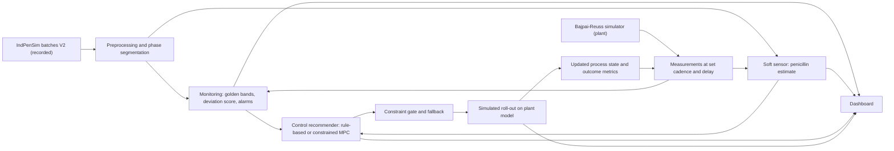

# Research Decision Report

Date: 2026-10-29. Author: OpenCode research workspace.

Working title: From Prediction to Trustworthy Closed-Loop Control: A Fault-Aware Digital-Twin Framework for Fed-Batch Fermentation (review deliverable) rescaled to a minimal monitoring-to-control research prototype.

Status: decision report for the smallest monitoring-to-control system. Builds on the verified literature corpus in references/. No code has been written yet.

## 1. Purpose and scope of this report

This report selects the smallest technically valid monitoring-to-control system for fed-batch penicillin fermentation that can support a defensible research paper.

It answers the eight questions in the master research prompt, compares three candidate directions, and fixes the architecture, experiment, and staged plan.

It reuses the verified bibliography, evidence matrix, and integrity rules of the existing review project.

It rejects the full digital-twin platform of the original brief, because the research question chosen here does not require it.

## 2. Evidence verification performed for this decision

All claims rest on sources verified on this date.

| Source | Verified record | Status |
|---|---|---|
| Zhang and Lennox 2004 | Journal of Process Control 14(1):41-50, DOI 10.1016/S0959-1524(03)00044-1 | Full text read |
| Acosta-Pavas et al. 2024 | Computers and Chemical Engineering 187:108736, DOI 10.1016/j.compchemeng.2024.108736 | Crossref record and full-text sections |
| Metcalfe et al. 2025 | Computers and Chemical Engineering 194:108991, DOI 10.1016/j.compchemeng.2024.108991 | Crossref record and publisher full text |
| Liu, Ni and Wang 2024 | Processes 12(3):495, DOI 10.3390/pr12030495 | Crossref record and abstract |
| Herrera-Contreras et al. 2026 | Processes 14(19):3110, DOI 10.3390/pr14193110 | Crossref record and abstract |
| IndPenSim dataset V2 | Mendeley Data, DOI 10.17632/pdnjz7zz5x.2, CC BY 4.0 | Record verified |
| San and Stephanopoulos 1989 | Biotechnology and Bioengineering 34:72-78, DOI 10.1002/bit.260340110 | Crossref record via reference chain |
| Lim et al. 1986 | Biotechnology and Bioengineering 28:1408-1420, DOI 10.1002/bit.260280915 | Crossref record via reference chain |

The existing corpus (19 priority sources, bibliography in references/references.bib, matrix in references/literature_matrix.csv) remains the baseline evidence base.

## 3. Refined project idea

A single-vessel, substrate-feed-focused, software-only monitoring-to-control pipeline for fed-batch penicillin fermentation.

The pipeline is: measurements, process monitoring, state estimation, control recommendation, simulated action, updated process state.

Two coordinated data tracks cover the two halves honestly.

Track 1 (recorded data): monitoring and soft-sensor state estimation on the released IndPenSim 100-batch benchmark.

Track 2 (simulation): closed-loop control experiments on a small first-principles penicillin simulator using soft-sensor-informed feedback.

The closed-loop claim is confined to Track 2.

Recorded-data prediction alone is never presented as closed-loop control.

## 4. Answers to the eight questions

### Q1. What is the simplest system that can genuinely monitor the process and generate meaningful control recommendations?

A four-component pipeline.

One, a data layer: the IndPenSim V2 recorded batches for monitoring and soft sensing, and a 4 to 6 ordinary-differential-equation Bajpai-Reuss simulator for control experiments.

Two, a monitoring layer: golden-batch-style per-time-point bounds with a deviation score, thresholds grounded in healthy batches of the benchmark.

Three, a state-estimation layer: a soft sensor for penicillin concentration from online process variables, starting with linear and tree baselines.

Four, a control layer: a rule-based feed policy as the default, a constrained MPC as the comparison arm, each emitting commands that are evaluated by simulator roll-out and filtered by a constraint gate with a no-action fallback.

Zhang and Lennox 2004 demonstrated on the Pensim penicillin simulator that a PLS soft sensor inside a moving-horizon controller, monitored by SPE and T-squared charts, is sufficient for integrated estimation, monitoring, and control.

Nothing more complex is required to test the research question chosen here.

### Q2. Which existing papers already demonstrate parts or all of that idea?

Zhang and Lennox 2004 integrated a PLS biomass soft sensor with predictive feed control and model-monitoring in one scheme on the penicillin Pensim simulator.

Montague et al. 1985 combined EKF biomass estimation from carbon dioxide with adaptive generalised predictive control on a 20 litre pilot plant.

Birol et al. 2002 built the modular Pensim simulator and applied it to monitoring and fault diagnosis.

Goldrick et al. 2015 and 2019 built IndPenSim, released the 100-batch dataset, demonstrated a Raman PLS soft sensor, and catalogued fault scenarios.

Acosta-Pavas et al. 2024 built interpretable soft sensors for penicillin on IndPenSim and reported a best Cubist model with R-squared 0.908, RMSE 3.149, and MAE 1.920.

Metcalfe et al. 2025 built an LSTM penicillin soft sensor on IndPenSim with an 8 hour forecast horizon and PSI-based drift monitoring, reporting MAE between 2.39 and 2.68 gram per litre on deviation batches.

Luo et al. 2024 built an offline golden-batch deviation and contribution method on IndPenSim and labelled 33 of 100 batches as below target.

Liu et al. 2024 built a fault-tolerant dual-LSTM soft sensor that maintains penicillin estimates when a sensor fails, on a simulated penicillin process.

Herrera-Contreras et al. 2026 built a batch-aware machine-learning framework for early warning, anomaly characterization, and 60 minute product forecasting on industrial fed-batch data, explicitly for operator decision support and with locked test sets.

Rashedi et al. 2022 put a hybrid linear or neural model inside constrained MPC and validated it in a real bioreactor, reporting that the linear model beat the neural network.

The classic optimal and predictive feeding literature for the Bajpai-Reuss penicillin model is mature, including San and Stephanopoulos 1989, Lim et al. 1986, and Rodrigues et al. 1996.

The integrated monitoring-estimation-control idea is therefore established on the Pensim lineage since 2004.

No peer-reviewed study was found in this decision phase that closes the substrate-feed loop on the released IndPenSim 100-batch dataset, or that quantitatively couples soft-sensor estimation accuracy to closed-loop control quality on this benchmark.

That absence is a gap hypothesis to re-verify by citation chaining in the implementation phase, not an established fact.

### Q3. What is the most defensible research question that remains?

Primary question: For fed-batch penicillin fermentation, does soft-sensor estimation accuracy measurably influence the quality of constrained substrate-feed control decisions, and can a simple monitoring layer flag process deviations early enough to inform those decisions?

Sub-question 1: Can a simple soft sensor match published penicillin-prediction baselines on held-out IndPenSim batches?

Sub-question 2: Does a golden-batch-style streaming monitor detect below-target IndPenSim batches earlier than the 12 hour plus 4 hour assay timeline, and at what false-alarm rate?

Sub-question 3: Under matched disturbances in a penicillin simulator, how does closed-loop feed control with soft-sensor feedback compare with a recipe baseline and with oracle state feedback, and does control quality degrade monotonically as estimation error increases?

The contribution is a quantitative, matched, reproducible measurement of the estimation-to-control coupling, not a new estimator or a new controller.

This is achievable in an undergraduate project because every component already exists and is documented.

### Q4. Which model and controller should be implemented first, and why?

Soft sensor: linear ridge regression first, then random forest, then PLS-style baseline aligned to the benchmark's own chemometrics.

LSTM is added only if it beats the simple models on held-out batches, following the simplicity-wins evidence of Rashedi 2022 and the competitive simple learners of Acosta-Pavas 2024.

Controller: a rule-based feed policy first because it is interpretable and is the conventional baseline; a constrained linearised MPC second, because the simulator provides a legitimate feed-to-state predictive model that the recorded data alone does not.

Oracle-feedback runs are included to bound the achievable control quality.

### Q5. What exact experiment would demonstrate whether the approach works?

Soft-sensor experiment: train on healthy IndPenSim batches, hold out complete batches, report MAE, RMSE, and R-squared against the published Cubist and LSTM baselines.

Monitoring experiment: compute online deviation scores against golden bands built from healthy batches within the same control regime, compare detection delay with the 12 hour plus 4 hour assay delay, and report false-alarm rate against the Luo labels.

Control experiment: matched simulation runs on the Bajpai-Reuss plant with a fixed recipe baseline, rule-based feedback, constrained MPC, and oracle feedback, all under identical initial conditions, disturbance seeds, and limits.

Estimation-error sweep: run each feedback controller at several injected estimation-error levels and measure final penicillin yield, tracking error, constraint violations, and feed use as a function of estimation error.

Falsification: if feedback control does not beat the recipe baseline, or if control quality is insensitive to estimation error, the estimation-to-control coupling hypothesis is falsified, which is still a valid scientific result.

### Q6. What data, tools, and implementation steps are required?

Data: IndPenSim Mendeley V2, DOI 10.17632/pdnjz7zz5x.2, CC BY 4.0.

Download the process-data summary files first; the full release is about 2.5 GB largely because of Raman data, which the initial prototype does not need.

The Bajpai-Reuss simulator is implemented in this project from the published equations, with parameter sets from published variants, and verified by mass-balance closure and qualitative reproduction of published behaviours.

Tools: Python, pandas, numpy, scipy, scikit-learn, matplotlib, statsmodels, streamlit for the dashboard, pytest for tests, git for version control, and a YAML configuration file.

Implementation steps follow the staged plan in section 8.

### Q7. What are the major scientific risks and how will they be controlled?

Risk: claiming control value from prediction-only evidence. Control is evaluated only in the simulator, and prediction accuracy is never presented as control performance.

Risk: data leakage. Splits are by complete batch, validation is chronological where that matters, the test set is locked, and all preprocessing and selection decisions are documented.

Risk: novelty overclaiming. The report records exactly what Zhang and Lennox 2004 and others already demonstrated, and novelty claims are limited to the quantitative coupling measurement after chaining.

Risk: unrealistic real-time claims. Real-time means accelerated replay and emulation with documented cadence and latency, not hardware operation.

Risk: simulator fidelity. The Bajpai-Reuss model is a declared approximation used only for a relative methodological comparison on the same plant for all arms.

Risk: benchmark artifacts. Units are checked against the summary file (penicillin totals appear in grams rather than kilograms), and monitoring results are reported within each control regime.

Risk: unnecessary complexity. Every component beyond the minimal set is gated by evidence that it beats the simpler alternative.

### Q8. Is the contribution sufficiently strong for a research paper, and what evidence is still needed?

The scoped contribution, an accurate and reproducible quantification of how soft-sensor accuracy shapes closed-loop feed-control quality on a standard penicillin benchmark with an open pipeline, is modest but defensible.

It is better suited to a workshop, a conference, or a strong thesis chapter than to a high-impact journal unless the results are unusually clear.

Evidence still needed: citation chaining to confirm the gap, dataset availability and unit verification, and the actual experimental results, which can only come after implementation.

All result claims in any paper must come from actual runs with pinned seeds.

## 5. Candidate comparison

| Criterion | A. Monitoring plus soft sensor only | B. Monitoring plus rule-based control recommendations | C. Monitoring plus constrained MPC |
|---|---|---|---|
| Scientific relevance | high | high | high |
| Existing work and novelty | heavily covered by Acosta-Pavas, Metcalfe, Luo, Liu, Herrera-Contreras | partially covered by Zhang-Lennox 2004 on Pensim; open quantified coupling | MPC for penicillin feed is classic (San 1989, Lim 1986, Rodrigues 1996) |
| Data requirements | IndPenSim only | IndPenSim plus a small simulator for control evaluation | IndPenSim plus a small simulator for control evaluation |
| Implementation difficulty | low | low to medium | medium |
| Fair experiment | yes | yes, matched arms | yes, matched arms |
| Research contribution | prediction and detection results only | estimation-to-control coupling with the classic baseline | adds a best-practice controller comparison |
| Major risks | no control evidence possible | none significant | MPC tuning burden and overclaiming risk |
| Reproducibility | high | high | high |

Recommendation: candidate B as the core delivery, with the constrained-MPC arm added as an explicit comparison.

This answers the prompt's requirement to compare at least two control strategies while keeping the default system simple.

## 6. Recommended architecture

Components:

| Component | Function | Source |
|---|---|---|
| Process data and plant | IndPenSim recorded batches and Bajpai-Reuss simulator | Mendeley V2; implemented from Bajpai 1980 |
| Preprocessing | phase segmentation, resampling, missing and stale handling, no-leakage batch splits | project |
| Monitoring | golden bands, deviation score, alarms with onset time | extends Luo 2024 to streaming |
| Soft sensor | penicillin estimate from online variables | baseline linear, random forest, optional LSTM |
| Control recommender | rule-based feed policy and constrained MPC, each with bounds and rejection logic | project |
| Simulated action and outcome | roll-out of the recommended feed on the plant model | project |
| Dashboard | replay, predictions, alarms, recommendations, outcomes, metrics | streamlit |

Mermaid diagram:

## 7. Experimental protocol summary

Hypotheses.

H1: a simple soft sensor matches or exceeds the published IndPenSim penicillin baselines on held-out batches.

H2: the streaming monitor flags below-target batches before the assay-confirmed timeline, within an acceptable false-alarm rate per control regime.

H3: soft-sensor-informed feed control changes final penicillin outcome relative to the recipe baseline, and control quality degrades monotonically with injected estimation error.

Leakage controls: batch-level splits, chronological ordering, locked test set, all preprocessing recorded.

Metrics: MAE, RMSE, R-squared for prediction; detection delay and false-alarm rate for monitoring; final yield, tracking error, constraint violations, and feed use for control; all repeated over seeded runs.

## 8. Staged implementation plan

Phase 0: environment, repository layout, data acquisition of the IndPenSim summary files, licence and version note.

Phase 1: preprocessing and dataset inspection, with unit and control-regime verification.

Phase 2: exploratory analysis and baseline monitoring.

Phase 3: soft-sensor baselines and held-out-batch evaluation against published numbers.

Phase 4: monitoring evaluation, detection delay, false-alarm rate, per-regime.

Gate G1: decide whether an LSTM arm is justified by the Phase 3 evidence.

Phase 5: Bajpai-Reuss simulator implementation and verification tests.

Phase 6: rule-based feed control with recipe, oracle, delayed-assay, and soft-sensor feedback arms under matched disturbances.

Phase 7: constrained MPC arm, matched to Phase 6.

Phase 8: dashboard integration, tests, documentation, decision log, and the research paper plan.

Gate G2: decide final paper scope based on Phase 6 and Phase 7 results.

## 9. Decision log

Adopted: recorded-data monitoring and soft sensing on IndPenSim, closed-loop control in a self-implemented penicillin simulator, rule-based controller as default with a constrained MPC comparison arm, simple models first, replay-based real-time emulation, streamlit dashboard.

Rejected: the full digital-twin architecture of the original brief, reinforcement learning, a hybrid mechanistic-plus-deep-learning primary model, multiple competing estimators, formal uncertainty calibration, and any production infrastructure.

Rationale for each rejection: complexity not required by the research question, and the literature shows simpler components are competitive.

## 10. Safety and integrity commitments

The prototype is research software, not an industrial control product.

No real actuators or control systems are touched.

Commands outside configured bounds are rejected.

Invalid, stale, or missing inputs trigger a conservative no-action fallback.

Alarms are distinguished from verified faults.

Every measured, predicted, simulated, and user-configured value is labelled in the interface and logs.

Simulated results and predictions are always labelled as such.

Deployment would require process-specific validation, fail-safe engineering, operator authorization, and regulatory assessment that are outside this project.

## 11. References for this decision

Zhang, H. and Lennox, B. (2004). Integrated condition monitoring and control of fed-batch fermentation processes. Journal of Process Control, 14(1), 41-50. DOI 10.1016/S0959-1524(03)00044-1.

Acosta-Pavas, J.C., Robles-Rodriguez, C.E., Griol, D., Daboussi, F., Aceves-Lara, C.A., and Corrales, D.C. (2024). Soft sensors based on interpretable learners for industrial-scale fed-batch fermentation: Learning from simulations. Computers and Chemical Engineering, 187, 108736. DOI 10.1016/j.compchemeng.2024.108736.

Metcalfe, B., Acosta-Pavas, J.C., Robles-Rodriguez, C.E., Georgakilas, G.K., Dalamagas, T., Aceves-Lara, C.A., Daboussi, F., Koehorst, J.J., and Corrales, D.C. (2025). Towards a machine learning operations (MLOps) soft sensor for real-time predictions in industrial-scale fed-batch fermentation. Computers and Chemical Engineering, 194, 108991. DOI 10.1016/j.compchemeng.2024.108991.

Liu, Y., Ni, D., and Wang, Z. (2024). A fault-tolerant soft sensor algorithm based on long short-term memory network for uneven batch process. Processes, 12(3), 495. DOI 10.3390/pr12030495.

Herrera-Contreras, H., Aviles-Noles, A., Noboa-Romero, P., Valle-Asan, S., and Vasconez-Viscarra, C. (2026). Batch-aware machine learning for early warning and soft sensing in industrial fed-batch fermentation. Processes, 14(19), 3110. DOI 10.3390/pr14193110.

Goldrick, S., Duran-Villalobos, C.A., Jankauskas, K., Lovett, D., Farid, S.S., and Lennox, B. (2019). Modern day monitoring and control challenges outlined on an industrial-scale benchmark fermentation process. Computers and Chemical Engineering, 130, 106471. DOI 10.1016/j.compchemeng.2019.05.037.

Luo, D., He, M., Darko, J., Ly Seymour, F., and Maturana, F. (2024). The golden batch-driven root cause analysis for anomalies in bioreactor fermentation process. Frontiers in Manufacturing Technology, 4, 1392038. DOI 10.3389/fmtec.2024.1392038.

San, K.Y. and Stephanopoulos, G. (1989). Optimization of fed-batch penicillin fermentation: A case of singular optimal control with state constraints. Biotechnology and Bioengineering, 34(1), 72-78. DOI 10.1002/bit.260340110.

All other sources are in references/references.bib.
